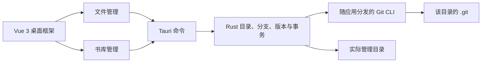

# FileManagementMaster 技术方案与开发计划

**文件管理大师**是一款面向 macOS 和 Windows 的本地文件管理应用，采用 **Vue 3 + Tauri 2 + Rust**。首版包含「文件管理」和「书库管理」两处入口。小说是首个专项管理场景，建库、分支、文件历史和回收能力也服务于日常文件整理。纳管文件可直接在 Finder 或 Windows 文件资源管理器中使用。[现有功能需求](./需求说明.md)

## 一、产品范围、架构与代码落点

### 首版模块

| 模块 | 用户任务 | 首版功能 |
| --- | --- | --- |
| 文件管理 | 整理一个目录中的普通文件，找回旧稿，在同一目录中管理不同用途的文件集合 | 打开或纳管目录、按目录层级浏览文件、使用系统默认应用打开文件、手动读取来源目录并按相对路径比对、保存外部变更、切换分支、跨分支移动所选文件、查看历史与恢复 |
| 书库管理 | 整理下载的小说，更新连载，按书目管理同一本书的不同格式 | 按后缀递归扫描、识别和归组书目、预览去重、追更导入、按书目或单文件跨分支移动、按书目和格式查看历史与恢复 |
| 共享能力 | 使用同一套目录、分支和版本机制 | 目录选择、当前与默认分支、变更预览、事务提交与中断恢复、版本保留、实际空间回收 |

**管理目录**指应用纳管的实际目录及对应仓库，也是现有 Rust `library` 代码的管理单位。两个模块可以查看同一个管理目录，使用同一个当前分支与同一套文件身份。同一文件的归属与历史保留单位以仓库记录为准。切换模块时保留当前目录和当前分支，切换分支则更新同一实际目录的内容。首次启动可从「文件管理」打开目录。后续启动进入上次成功打开的模块和目录，按现有规则进入该目录的默认分支。

后续模块按具体文件类型或整理任务逐项确定。每个新模块先明确入口、组织方式、需要的专属元数据和可验收的操作，再接入现有目录、分支、版本和事务能力。同一目录由同一仓库和一把写锁管理，已纳管文件的身份和归属从仓库读取。

### 应用架构

| 代码位置 | 本轮改造与职责 |
| --- | --- |
| `src/App.vue`、`src/library-types.ts` | 调整为应用框架和共享目录状态，承接模块入口、目录、分支和后台任务结果。将普通文件和书目呈现放到各自页面。 |
| `src/LibraryReading.vue`、`src/library.css` | 重整扫描与读取预览的层级。系统字体、亮暗色、选中态、列表和确认面板形成两模块共享的样式。 |
| `src-tauri/src/lib.rs`、`src-tauri/src/commands.rs` | 继续提供目录选择、系统打开和结构化操作结果。文件管理需要的能力经现有命令入口提供，路径校验在 Rust 完成。 |
| `src-tauri/src/library.rs`、`src-tauri/src/library/` | 复用建库、文件和书目标识、分支、读取、移动和历史。普通文件按路径及文件身份处理，小说规则由 `novel.rs` 与 `reading.rs` 承载。 |
| `src-tauri/src/git.rs`、`src-tauri/src/worktree.rs` | 作为两模块的存储基础，执行随包 Git、更新引用与索引、落盘、恢复和回收。 |
| `src-tauri/tauri.conf.json`、`src-tauri/tests/`、`.github/workflows/desktop.yml` | 配置桌面窗口及发行资源，使用安装产物、真实 Git 和隔离目录做双端验收。 |

Vue 通过应用命令传入库内标识、所选分支或经用户选择的源目录。Rust 校验路径、预览对应的状态版本和本次操作要修改的文件，负责所有写入。扫描、对象读写和回收通过后台任务执行，界面显示进度和结果。Tauri 提供 Vue 项目模板和 Rust 命令桥接。 [Tauri 项目模板](https://v2.tauri.app/start/create-project/) · [调用 Rust 命令](https://v2.tauri.app/develop/calling-rust/)

## 二、Git 引擎选型

**选定随应用打包的 Git CLI，使用 reftable 引用格式初始化书库。** Rust 通过绝对路径启动随包 Git，以参数和标准输入传参。对象读写、提交、引用发布和对象回收都使用同一套 Git 命令。

| 选型 | 对本项目的影响 |
| --- | --- |
| Git CLI + reftable | 提供构建提交、整组更新引用和对象回收。reftable 将同次更新写入一张新表，通过原子更新表列表发布，适合同时更新两个分支和书库状态。 [Git reftable 更新事务](https://git-scm.com/docs/reftable#_update_transactions) · [Git 多引用更新](https://git-scm.com/docs/git-update-ref) |
| `git2` / libgit2 | 可以在进程内访问对象和分支。其多引用事务逐项提交，出错前成功的更新可能已经生效，跨分支移动需要应用额外承担这部分一致性。 [libgit2 事务提交](https://libgit2.org/docs/reference/main/transaction/git_transaction_commit.html) |

- **macOS** 从 Git 2.56.1 上游源码为目标架构构建运行时。Git 主程序及用到的辅助程序和依赖随应用签名并打入 DMG。 [Git 2.56.1 上游版本](https://github.com/git/git/blob/v2.56.1/Documentation/RelNotes/2.56.1.adoc) · [macOS 签名](https://v2.tauri.app/distribute/sign/macos/)
- **Windows** 使用 Git for Windows 发布 `2.56.1.windows.1` 中的 MinGit，保持它的运行时目录结构，随 Tauri NSIS 安装包分发。 [MinGit 发布及校验值](https://github.com/git-for-windows/git/releases/tag/v2.56.1.windows.1) · [Windows 安装包](https://v2.tauri.app/distribute/windows-installer/)
- **构建验收**固定运行时来源和校验值，随包保留分发所需的许可证与归属材料。安装后在干净系统验证 Git 版本、辅助程序解析、初始化、引用事务和回收。首轮真机验收以 macOS arm64 和 Windows x64 为基准。

Git 执行器限定仓库、工作目录和内部命令，使用应用控制的 Git 配置及空模板。路径型输入使用相对路径校验和零字节分隔的命令格式，保留空格、引号和中文。现有目录建库时识别应用已管理的仓库，发现目录已有其他 Git 仓库时提示另选独立书库目录。 [Tauri 外部二进制](https://v2.tauri.app/develop/sidecar/)

## 三、仓库和版本的数据结构

每个书库有一个真实工作目录，使用 `git init --ref-format=reftable` 初始化。默认直接纳管用户选中的目录。独立建库使用新建的子目录作为工作目录，这个子目录是独立纳管范围。手动读取来源目录时按现有文件形成新增或更新预览，确认后写入书库。

| 存储位置 | 数据和用途 |
| --- | --- |
| `refs/heads/<分支名>` | 指向本分支当前文件树的 Git 提交。每次更新生成新的无父提交，即一个独立的当前快照。 |
| `HEAD` 与 Git index | `HEAD` 指向实际打开的分支，index 记录工作目录对应的已提交文件。默认分支属于书库设置。 |
| `refs/filemanagement/state` | 指向书库状态的独立提交。树中的 `catalog.json` 保存格式版本、操作 ID、默认分支、书目和文件标识、各分支的路径映射与版本顺序。 |
| 应用状态提交中的 `history/` 树 | 以保留单位和版本号定位旧版，树条目**直接引用对应 Git blob**。 |
| `.git/filemanagement/` | 书库写锁、未完成操作记录、暂存原件及待回收标记。 |

分支提交和状态提交都由 `commit-tree` 创建，提交时省略父提交。更新会生成新的 Git 提交，应用通过有限的历史树提供文件恢复。新增空分支时，把空树的快照和书库状态一起提交。目录里的 JSON 用于查找版本，文件内容的可达性由 Git 树中的 blob 引用保证。 [创建 Git 提交对象](https://git-scm.com/docs/git-commit-tree) · [Git 对象与树](https://git-scm.com/book/en/v2/Git-Internals-Git-Objects)

普通文件用稳定文件 ID，小说用稳定书目 ID。书目内按文件格式保留版本。分支文件路径映射到文件或书目及对应版本，移书和改名沿用标识。普通文件从外部改名时，确认它和原文件的对应关系后再沿用历史。

文件通过 `git hash-object -w --stdin` 按原字节入库，以 `git cat-file` 读回，同一内容可以共用 Git 对象。使用独立的 `GIT_INDEX_FILE` 从原文件树装配待提交的树，实际工作目录的 index 在提交发布后更新。 [Git 原字节入库](https://git-scm.com/docs/git-hash-object) · [Git index 更新](https://git-scm.com/docs/git-update-index) · [从树更新 index](https://git-scm.com/docs/git-read-tree)

## 四、跨分支移动与中断恢复

用户选中书目时，移动它在当前分支的全部格式和分卷。选中具体文件时，移动选中的文件。移动完成后，实际目录继续展示源分支，选中的文件从源分支移除，切到目标分支后可打开。

1. **预览并检查。** 读取源分支、目标分支和书库状态的当前 OID。列出将移动的路径以及目标分支中同路径异内容、路径冲突等情况。确认时再次校验引用和受影响文件内容，并检查路径归属，包括大小写冲突、目录联接或符号链接越界、暂存位置是否同卷。如果书库里有尚未保存的新增或修改，先由用户确认保存到原分支，再基于保存结果生成移动。
2. **生成新提交。** 以两个分支的原文件树为基础，在各自的临时 index 做路径级增删。目标树直接引用源文件的 blob，保留书目、格式和版本标识。生成源、目标及新书库状态三个提交。目标分支的变动此时都在 Git 对象库中。
3. **先记下事务，再落盘。** 将操作 ID、全部受影响引用的旧值和新值，以及每个工作区路径的原内容、预期新内容和暂存路径持久化。把源分支所选文件同卷重命名到该操作的暂存目录并校验内容。其他操作需要新增或替换文件时，从准备好的暂存内容同卷重命名到目标路径。每一步都要求重命名的目标路径空闲。
4. **一次发布 Git 引用。** 用 `git update-ref --stdin` 的 `start`、`prepare`、`commit` 协议，携带预期的旧 OID，在一笔 reftable 事务中更新两个分支和状态引用。两个分支各有一次 Git 提交，书目和历史与文件状态在同一个提交点发布。
5. **完成工作目录。** 以发布后的当前分支树执行 `git read-tree` 更新实际 index，核对受影响的文件路径和内容。清理暂存和操作记录后，应用才报告移动成功。

macOS 使用 `renamex_np` 的 `RENAME_EXCL`。Windows 使用 `MoveFileExW` 的同卷移动且目标须空闲的语义。Windows 上其他程序持有的文件句柄可能禁止删除或重命名，移动阶段应返回具体受占用路径。Finder 和文件资源管理器可能在事务执行期间看到文件逐个变化，应用以引用已发布且工作目录处理完成作为成功条件。 [Windows 文件移动](https://learn.microsoft.com/en-us/windows/win32/api/winbase/nf-winbase-movefileexw) · [Windows 文件共享模式](https://learn.microsoft.com/en-us/windows/win32/api/fileapi/nf-fileapi-createfilew)

### 重开书库时如何恢复

每个书库只有一个应用写入者。应用对同一仓库串行执行提交、工作目录变更和回收。Git 执行器管理 macOS 上的子进程组和 Windows 上的 Job Object，在允许写进程访问仓库前记录进程身份和启动时间。重新打开时先取得书库排他锁，确认上次的 Git 写进程及子进程已退出，再进入恢复。此时可以清理已确认属于上次操作的 Git 遗留锁，并核对实际引用。

| 读取到的持久状态 | 恢复动作 |
| --- | --- |
| 操作记录中的引用均是旧值 | Git 事务尚未发布。按操作记录撤除本次已放入的文件，归还已暂存原件，恢复原索引。 |
| 操作记录中的引用均是新值 | Git 事务已经发布。按新快照完成 index 更新和文件核对，处理暂存和操作记录。 |
| 路径已出现未知内容，或引用与记录无法对应 | 保留实际文件和暂存原件，标明冲突并等待处理。书库写入和回收在恢复完成后继续。 |

根据操作专属暂存路径和内容 OID 验证已执行的文件步骤，恢复可以重复进行。撤除计划文件时必须确认它仍是本操作写入的内容。归还原件使用目标须空闲的同卷重命名。暂存原件在清理之前再次核对，出现额外修改时保留并提示。即使 Git 子进程返回错误，也以重读到的持久引用决定恢复方向。macOS 实测强杀已 `prepare` 的 Git 子进程会留下 `tables.list.lock`，因此进程身份和遗留锁清理属于第一阶段验收。

普通切换分支也沿用该操作记录和文件落盘流程。先保存用户确认的外部改动，再应用目标分支与当前目录的文件差异。引用事务用 `option no-deref` 和 `symref-update` 校验并更新 `HEAD` 的符号目标，随后更新 index。启动应用时切回默认分支走同一流程。 [Git 符号引用更新](https://git-scm.com/docs/git-update-ref)

## 五、旧版如何实际回收

### 计算该保留的版本

1. 以操作完成后的**全部分支**当前文件树为准，找出每个保留单位正在使用的版本。任一分支还在使用的版本都算当前版，全部另计。
2. 小说按**书目和格式**分别计算，普通文件按稳定文件 ID 计算。在已知版本中排除当前版，按保存顺序取最近 10 个。移动和改名沿用顺序。相同内容复用版本记录。显式恢复作为一次新保存生成快照，复用其内容记录并更新保存顺序。
3. 在新状态树中直接引用应保留的旧版 blob。淘汰记录从该单位的历史中移除，旧状态提交随状态引用前移而失去引用。若另一分支或另一保留单位还在使用同一个 blob，由实际引用继续保护。

例如「常看」使用 TXT 第 15 版，「收藏」使用第 3 版。两版都算当前版。其余有效历史保留第 5 至第 14 版，EPUB 有独立的窗口。「收藏」更新到第 15 版后，第 3 版纳入 TXT 的旧版计算，超出窗口时从历史树移出。

### 执行物理清理

- 初始化书库时设置 `core.logAllRefUpdates=false`、`gc.auto=0` 和 `maintenance.auto=false`，由应用按书库操作安排维护。无父快照避免旧提交祖先持续保留文件。完成操作时先对齐实际 index，再清除已处置的暂存文件，并持久化待回收标记。标记落盘后才结束操作记录。
- 待回收标记由同一书库的后台写队列处理，多个操作可以合并为一次清理。取得排他锁并确认书库已对齐工作目录、index 和引用后，运行 Git 子进程 `git gc --prune=now --no-detach` 并等待退出，由 Git 打包并清除不可达对象。GUI 继续响应，新的书库写入在清理进程退出后执行。
- 回收结束后记录对象库实际占用变化。异常退出时保留待回收标记，重新打开书库先确认旧 Git 进程已结束，再执行清理。验收通过 `git cat-file -e` 检查失去引用的 blob 已移除，并确认应保留版本可恢复、仓库通过 `git fsck --full --strict`、样本的 `.git/objects` 文件总大小下降。

Git 会保护分支、索引、reflog 等仍能到达的对象。即时清除会与并发写对象产生冲突，因此操作恢复、引用发布和回收共用排他边界。 [Git 垃圾回收和并发约束](https://git-scm.com/docs/git-gc#_notes) · [reflog 配置](https://git-scm.com/docs/git-config#Documentation/git-config.txt-corelogAllRefUpdates)

## 六、建库、扫描和恢复的操作链路

| 操作 | 实现与用户可见结果 |
| --- | --- |
| 直接纳管 | 在选定目录初始化仓库，以已有文件生成初始快照和默认分支。文件仍在原始目录，Finder 或文件资源管理器可以直接打开。 |
| 独立建库和手动读取 | 新建子目录作为书库，来源目录供手动读取。普通文件按路径和内容比对，小说按书目及格式匹配。预览后将确认的新增或更新提交到书库。递归扫描跳过 `.git` 和独立子库目录，防止重复纳管。 |
| 递归扫描 | Rust 从选定根目录查找已勾选后缀。默认启用 `.epub`、`.txt`、`.mobi`、`.azw3`，其余后缀沿用需求表。忽略后缀大小写，按完整后缀匹配 `.fb2.zip`。路径保留用于定位，书名、作者和进度从文件名提取。 |
| 去重与追更 | 同书同格式且覆盖范围可比较时推荐新版，无法直接判断的书名、分卷和进度要确认。同书不同格式各自保留。旧版只在一个分支时预选该分支，多分支时由用户选择。首次纳管需要保留的旧版先写入 Git，再移除被替换的文件。 |
| 恢复旧版 | 从对应历史树读取选定版本的字节，预览目标路径后更新单个文件，生成新快照，并按全部分支的当前版本重新计算保留窗口。 |

## 七、桌面界面与交互

### 现有界面的调整

| 截图中的表现 | 改版方向 |
| --- | --- |
| 窗口标题与页面内重复显示产品名，大号衬线标题和完整路径占用首屏 | 保留系统标题栏，工具栏用紧凑标题显示当前目录。主列表靠近顶部，完整路径放在路径栏或详情中，可复制。 |
| 分支表单、引擎验证、回收和文件动作同时占据主界面 | 分支使用侧边栏和行菜单。清理归入当前目录的空间管理，引擎验证从「帮助 → 诊断」打开。选中项目后显示适用的移动、历史等操作。 |
| 书目、文件与移动表单堆在同一张卡片，所选对象和操作范围较难辨认 | 用列表、展开行和按需详情组织书目与文件。移动、追更和恢复从所选对象进入确认界面，明确列出目标分支、受影响文件和冲突。 |
| 强调色面积大，多处边框、按钮和卡片争夺视觉注意 | 采用系统字体、中性色背景、细分隔线和一致的紧凑控件。强调色用于选中、键盘焦点和确认动作。 |

### 信息布局与系统风格

- **侧边栏**上部是「文件管理」「书库管理」，下部列出当前管理目录的分支。当前分支用选中态和文字标识，默认分支用次要标记。用「+」新建分支，在分支行菜单中设为默认。
- **工具栏**显示当前目录和常用入口。「打开目录」或「在 Finder 中显示」等系统动作按上下文显示。文件管理提供「读取来源目录」，书库管理提供「扫描小说」和「导入更新」。空间管理放在目录菜单。
- **内容区**以列表为主。文件管理显示文件夹层级和文件名，书库管理按书目显示书名、作者、格式与可判断的更新进度。展开书目后可选择整本或单文件。相同书名按作者区分，同一书目内的格式和分卷可单独选中。路径、版本和操作结果可在详情中查看。
- **macOS**采用系统标题栏、应用菜单、系统字体、目录选择对话框和清晰的键盘焦点。小范围确认用依附当前窗口的对话面板，批量扫描和冲突处理用可滚动的预览列表。浅色、深色与减少动态效果随系统设置，图标保持统一。 [macOS 设计指南](https://developer.apple.com/design/human-interface-guidelines/designing-for-macos) · [排版](https://developer.apple.com/design/human-interface-guidelines/typography) · [工具栏](https://developer.apple.com/design/human-interface-guidelines/toolbars) · [附属对话框](https://developer.apple.com/design/human-interface-guidelines/sheets)
- **Windows**复用同一导航与任务顺序，采用系统窗口控件、文件资源管理器、系统目录选择对话框和 Ctrl 快捷键。在两端验证系统缩放、键盘操作和焦点提示。 [Windows 设计指南](https://learn.microsoft.com/en-us/windows/apps/design/guidelines-overview) · [Windows 标题栏](https://learn.microsoft.com/en-us/windows/apps/design/basics/titlebar-design)

桌面窗口以现有默认尺寸 890 × 680 和最小尺寸 420 × 410 逻辑像素作为验收点。窄窗口可收起侧边栏和详情，工具栏次要命令收入「更多」。首屏显示文件、所选数量和当前分支，长名称可在详情查全。列表支持方向键移动焦点、Shift 连选以及 Command 或 Ctrl 多选。`⌘O` 或 `Ctrl+O` 打开目录，`⌘F` 或 `Ctrl+F` 筛选当前列表，Esc 退出待确认预览。关闭面板后，焦点回到发起控件或列表中相邻的可操作项。

### 关键操作流程

| 任务 | 交互及结果 |
| --- | --- |
| 打开目录或书库 | 从模块入口选择目录。已有仓库直接打开，新目录按直接纳管或新建独立管理目录确认。首次进入显示实际路径和当前分支。空目录提供读取来源的入口。 |
| 切换模块和分支 | 切换模块展示同一目录对应的视图。切换分支时如有外部改动，先列出文件和原分支，再由用户选择「保存并切换」或「取消」。完成后列表和 Finder 或文件资源管理器内容同时对齐目标分支。 |
| 移动文件或整本书 | 从选择状态进入「移至分支」，在一处确认源分支、目标分支和文件清单。冲突项就地填写新目标路径。提交完成后更新当前列表，并显示移动数量和目标分支。 |
| 手动读取、去重和追更 | 文件管理按相对路径显示新增与更新。书库管理先选来源与格式，再展示书名和作者候选、按格式的替换建议以及目标分支。相应版本只在一个分支时预选该分支，多个分支时由用户指定。提交前可返回或调整选择。 |
| 查看和恢复历史 | 选中单个文件打开版本详情，分别显示各分支的当前版与可恢复旧版。书库明确当前查看的格式。选定旧版后预览恢复位置，再确认保存。按现有规则，小说每书每格式、普通文件每文件最多保留 10 个旧版，所有分支仍引用的版本另计。 |
| 后台处理和重开恢复 | 扫描、提交、回收显示实际状态或进度，回收结束显示占用变化。预览失效时提示重新核对。应用重开后在相关目录显示恢复结果，遇到冲突时显示需要处理的文件或路径。 |

设计评审用打开普通文件目录、从下载目录追更、找回一份旧稿和在系统文件管理器中定位文件四个任务检验入口。检查选中态、待保存的外部改动、同名冲突、空列表与长中文路径。亮暗色下都应清楚显示焦点、当前分支和操作结果。最小窗口与系统缩放下，关键操作应可见或能从「更多」进入，并能用键盘完成。

## 八、开发计划与验收

| 阶段 | 开发内容 | 完成条件 |
| --- | --- | --- |
| 1. 双端引擎与仓库基线 | 搭建 Vue、Tauri、Rust 项目，固定随包 Git、reftable 命令和仓库格式。实现 Git 命令运行、临时 index 和操作记录原型。 | macOS 与 Windows 在干净环境能启动随包 Git。通过两分支加状态引用事务、符号 `HEAD` 更新、子进程中断和实际回收验证。 |
| 2. 建库、保存和切分支 | 实现直接纳管、独立建库、稳定标识、版本保留计算、创建分支、当前及默认分支、工作目录差异和外部变更确认。接上书库和分支界面。 | 在 Finder 和文件资源管理器确认相同路径的内容随分支切换。外部新增和修改经确认先进入原分支，子库的文件归各自仓库。 |
| 3. 跨分支移动和恢复 | 实现书目或单文件选择、冲突预览、准备 Git 对象、暂存、引用发布和中断恢复。以已归入书目的文件验证批量移动。 | 选中书目时各格式与分卷按预期移动。模拟部分暂存、旧 OID 校验失败、提交后 index 未更新、Windows 文件占用和重启，结果可恢复且文件字节正确。 |
| 4. 书目、追更和有限历史 | 实现递归扫描、同书识别、去重、手动读取、追更路由、单文件历史与实际回收。 | 用样例覆盖多层目录、双后缀、同名不同作者、连载、分卷、完本及多格式。每格式超过 10 个旧版时检查保留窗口、其他分支的当前版保护、共享对象及回收后的占用。 |
| 5.1 界面与交互评审 | 确认应用框架、两个模块的首屏与关键任务。准备亮暗色、窄窗口、移动冲突、追更和历史恢复稿。 | 评审通过导航、布局和操作流。首次打开、键盘操作、取消、失败与恢复状态都有明确入口或反馈。 |
| 5.2 应用框架与文件管理 | 从现有 Vue 主界面抽出侧边栏、工具栏和共享目录状态，接通普通文件列表、目录纳管、读取、分支和历史操作。 | 用前四阶段创建的目录打开文件。两模块切换后目录、当前分支和对应版本一致，Finder 或文件资源管理器能打开相同实际路径。 |
| 5.3 书库管理改造 | 将书目、递归扫描、去重、追更、移动与版本恢复迁入新框架，调整预览和错误反馈。 | 跑完整本与单文件移动、异格式保留、冲突确认、追更目标选择、独立历史和恢复。检查分支引用、文件字节和版本保留规则。 |
| 5.4 双端发行前验收 | 使用改版后的界面构建 macOS arm64 DMG 和 Windows x64 NSIS，从安装后的应用运行两模块主流程，记录耗时、峰值磁盘和路径兼容性。 | 双端安装后通过建库、切换、移书、追更、恢复和实际回收，覆盖中文及空格路径、大小写冲突、长路径、大文件和进程中断。 |

第 1 至 4 阶段的功能和仓库行为作为回归基线。先完成界面评审，再按应用框架、文件管理和书库管理的顺序接入，最后以改版后安装包验收。Mac 用 Finder、Windows 用文件资源管理器交叉核对文件。在终止进程并重开后，分别核对提交前还原原件和提交后修复索引。用随包 Git 验证引用一致、可达版本保留、超限对象已清除和仓库完整性。

## 九、已有验证与发版记录

- 第 1 至 4 阶段已有 Mac 原生窗口和随包 Git 的功能测试记录。当前目录已有 macOS arm64 DMG 构建产物。改版后 DMG 安装验收和 Windows x64 NSIS 打包及原生验收列入 5.4。[开发与验证记录](./README.md)

- **本机 Git 验证**使用 macOS arm64、Git 2.51.0 和隔离的 reftable 仓库。通过了旧引用校验失败时整组引用保持旧值、暂存原件恢复、提交后重建 index、符号 `HEAD` 更新，以及实际目录内容变化。
- **本机回收验证**分别保留 TXT 和 EPUB 的 10 个旧版。另一分支使用的早期 TXT 和其他文件使用的共享对象均保留。释放最后一个分支引用后，超限版本的对象实际消失。一次随机内容样本的对象库由 921,703 字节降到 791,999 字节，仓库通过完整性检查。该数字用于验证回收发生。
- **本机文件验证**确认 macOS 的独占重命名会保留已存在的目的文件。Windows 的文件占用、进程恢复、随包 Git 2.56.1 和两端安装包列入开发验收。
- **方案行为**手动读取定义为从选定目录预览并应用新增或更新。恢复保存复用同内容的版本记录，并将它视作一次新的保存。旧对象在后台排他任务完成后实际释放。
